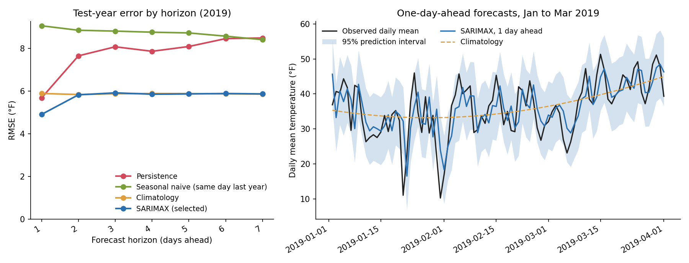

# Forecasting Daily Temperature at JFK Airport

How many days ahead can a statistical time-series model forecast daily mean temperature better than simple rules of thumb? This project answers that for New York's JFK Airport with seven years of NOAA observations, a SARIMAX model and a rolling-origin evaluation against persistence, seasonal-naive and climatology baselines. The answer sets realistic expectations for any demand, staffing or energy plan that leans on temperature forecasts.

## Key results

Test year 2019, scored once: 359 forecast origins, each forecasting 1 to 7 days ahead using only data available that day. RMSE in °F (lower is better).

| Method | 1 day ahead | 3 days | 7 days |
|---|---|---|---|
| Seasonal naive (same day last year) | 9.05 | 8.80 | 8.40 |
| Persistence (tomorrow equals today) | 5.67 | 8.07 | 8.48 |
| Climatology (long-run mean for the date) | 5.88 | 5.87 | 5.86 |
| **SARIMAX: annual Fourier terms + AR(3) errors** | **4.90** | **5.91** | **5.86** |

- **One day ahead**, SARIMAX cuts RMSE by 17% against climatology and 14% against persistence (Diebold-Mariano, Holm-adjusted p < 0.001 for both).
- **From two days ahead** it is indistinguishable from climatology (adjusted p = 1.0 at every horizon from 2 to 7) while still beating persistence at every horizon. Day-to-day weather memory in daily means fades within about two days.
- **Calibrated intervals:** nominal 95% prediction intervals cover 94.4% of outcomes one day ahead and 96% to 97% at longer horizons. Coverage is 92% in winter and 100% in summer: weather is more variable in winter than the model's single variance assumes.



## Approach

- **Year-based train/validation/test split.** Parameters are estimated on 2013 to 2017, the model specification is chosen on 2018, and 2019 is used once for the final evaluation, after refitting on 2013 to 2018.
- **Rolling-origin evaluation.** From every day of the evaluation year, each method forecasts 1 to 7 days ahead. Parameters stay fixed while the Kalman filter absorbs each new observation, so forecasts never use future data (a unit test checks this by tampering with future values).
- **Dynamic regression (SARIMAX).** Annual seasonality enters as Fourier sine/cosine terms and short-term weather persistence as ARMA errors. Fifteen candidates (1 to 3 harmonics, five ARMA orders) were compared on 2018 by RMSE averaged over horizons. Fits that don't converge are excluded; all fifteen converged.
- **Meaningful baselines.** Persistence, a 365-day seasonal naive and a Fourier climatology (harmonics also chosen on 2018). An earlier version used a 7-day seasonal naive and a weekly seasonal AR term, which were dropped: daily temperature has no weekly cycle.
- **Forecast comparison with proper inference.** Diebold-Mariano tests with the Harvey-Leybourne-Newbold correction and a variance that accounts for overlapping multi-day errors, Holm-adjusted across all 14 comparisons. Skill scores against climatology and persistence.
- **Diagnostics.** Interval coverage by horizon and season, Ljung-Box tests (lag 14 p = 0.36) and a Q-Q plot of the final model's residuals ([figures/residual_diagnostics.png](figures/residual_diagnostics.png)).

## Data

- **Source:** NOAA National Centers for Environmental Information, [Local Climatological Data](https://www.ncei.noaa.gov/products/land-based-station/local-climatological-data), station 74486094789 (JFK International Airport, NY), yearly files for 2013 to 2019. U.S. government data, free to use.
- **Unit of analysis:** one calendar day, January 1, 2013 to December 31, 2019 (2,556 days). The value is the mean dry-bulb temperature (°F) of the routine hourly reports, one per clock hour (61,341 hourly readings). Special reports, which cluster in bad weather, and duplicate synoptic reports are excluded so they don't over-weight particular hours. Every day has at least 23 valid hourly readings; nothing is imputed.
- `scripts/prepare_noaa_data.py` downloads the seven source files, verifies their SHA-256 checksums and rebuilds `data/jfk_daily_temperature_2013_2019.csv`. URLs, checksums and row counts are in [data/source_metadata.json](data/source_metadata.json).
- The project began as IBM data science coursework on a single year of this station's data (archived in the `DAX-Weather-Project` repository) and was rebuilt with seven years of data and a rolling-origin evaluation.

## Repository structure

```
├── weather_forecasting.py             # data contract, baselines, SARIMAX, rolling forecasts, DM test
├── run_analysis.py                    # selection on 2018, final evaluation on 2019, outputs and figures
├── weather_forecasting_sarimax.ipynb  # walkthrough with outputs
├── scripts/prepare_noaa_data.py       # download, checksum and daily aggregation
├── data/                              # daily series and source metadata
├── outputs/                           # metrics.json and row-level validation/test forecasts
├── figures/                           # test-year results and residual diagnostics
├── archive/                           # superseded 2017-only daily file
└── tests/
```

## Reproduce

```bash
python3.12 -m venv .venv && source .venv/bin/activate
pip install -r requirements.txt
python scripts/prepare_noaa_data.py   # optional: re-download and rebuild data/ (about 65 MB)
python run_analysis.py                # about 10 seconds; rewrites outputs/ and figures/
pytest -q
jupyter nbconvert --to notebook --execute --inplace weather_forecasting_sarimax.ipynb
```

## Limitations

- One station and one test year, so the results may not carry over to other climates or years. Errors on consecutive days are correlated, so 359 origins carry less information than 359 independent tests.
- The model uses past temperature alone. Operational forecasts beat climatology for a week or more because they use numerical weather prediction; this analysis measures what temperature history alone can do.
- Error variance is assumed constant through the year. Winter intervals are too narrow (92% coverage) and summer intervals too wide (100%); a seasonal variance model would fix this.
- The residual distribution has a heavy left tail from cold outbreaks, so the Gaussian intervals understate the chance of sharp temperature drops.
- Daily means hide intraday extremes, which matter for some uses such as peak energy demand.
